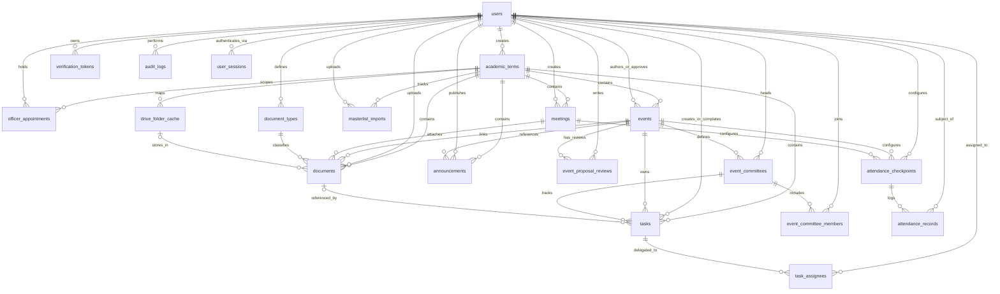

## 1. Document Identity

- **Document ID:** `03-domain-model-and-data-dictionary.md`
    
- **System:** SYComP Organizational Management System (SYComP OMS)
    
- **Document Status:** v1.2 — Verified Baseline
    
- **Phase:** Phase 5 — Domain Modeling
    
- **Dependencies:** [[00 — Project Charter SYComP Organizational Management System]], [[01 — Requirements Specification SYComP Organizational Management System]], [[02 — Organizational Workflow & Policies SYComP OMS]], [[02b — Business Rules & Workflow Design SYComP OMS]]
    

## 2. Modeling Conventions & Design Standards

- **Primary Keys:** All primary domain entities use opaque `UUID` (v4 or v7) primary keys to prevent sequential ID enumeration in URLs and APIs. Pure many-to-many join tables (`event_committee_members`, `task_assignees`) use composite primary keys `(parent_id, user_id)`.
    
- **Timestamps:** All temporal fields are stored in UTC (`TIMESTAMP WITH TIME ZONE` / `TIMESTAMPTZ`). Standard mutable tables include `created_at` and `updated_at`. Append-only tables (`audit_logs`, `event_proposal_reviews`, `masterlist_imports`) and insert/delete-only join tables (`event_committee_members`, `task_assignees`) omit `updated_at`.
    
- **Non-Destructive Lifecycle (`BR-SYS-02`):** Core historical tables (`users`, `academic_terms`, `officer_appointments`, `events`, `meetings`, `attendance_records`) prohibit hard deletes at the application and foreign-key levels (`ON DELETE RESTRICT`).
    
- **Strict Relational Ownership (No Weak Polymorphism):** Rather than using untyped `entity_type + entity_id` pairs on `attendance_checkpoints`, the model uses mutually exclusive nullable foreign keys (`event_id` XOR `meeting_id`) enforced via database `CHECK` constraints so referential integrity is guaranteed natively.
    
- **Decoupled Authorization (`BR-SYS-03`):** Global tier (`users.system_role`), historical title (`officer_appointments.position_title`), and event-committee authority (`event_committees.head_user_id`) are explicitly separated.
    

## 3. Domain Aggregates Overview

The domain is organized into **6 cohesive aggregates** spanning **19 core domain entities**, plus **2 security/session infrastructure tables** (Section 5.7) for **21 PostgreSQL tables** total:

|                                   |                                                                                                |                                                                                                     |
| --------------------------------- | ---------------------------------------------------------------------------------------------- | --------------------------------------------------------------------------------------------------- |
| **Aggregate**                     | **Entities**                                                                                   | **Core Responsibility**                                                                             |
| **1. Identity & Governance**      | `users`, `verification_tokens`, `academic_terms`, `officer_appointments`, `masterlist_imports` | Accounts, masterlist provisioning, OTP recovery, term rollovers, and officer history.               |
| **2. Events & Committees**        | `events`, `event_proposal_reviews`, `event_committees`, `event_committee_members`              | Proposal-to-archive lifecycle, review feedback, event-bound committees, and single-head assignment. |
| **3. Execution & Tasks**          | `tasks`, `task_assignees`                                                                      | Committee and org-wide deliverable tracking with Executive override capability.                     |
| **4. Officer Meetings**           | `meetings`                                                                                     | Standalone internal officer meetings decoupled from public events.                                  |
| **5. Dynamic Attendance**         | `attendance_checkpoints`, `attendance_records`                                                 | Flexible single/multi-session checkpoints and QR-backed, role-governed logging.                     |
| **6. Documents, Notices & Audit** | `document_types`, `drive_folder_cache`, `documents`, `announcements`, `audit_logs`             | Dynamic Google Drive routing, file metadata, Executive announcements, and immutable audit trail.    |

## 4. Entity-Relationship Diagram (ERD)

## 5. Complete Data Dictionary

### 5.1 Identity & Governance Aggregate

#### Table 1: `users`

Stores all system accounts across `Super Admin`, `Executive`, `Officer`, and `Member` tiers.

|                        |                  |          |             |                                                                                                                                                                             |
| ---------------------- | ---------------- | -------- | ----------- | --------------------------------------------------------------------------------------------------------------------------------------------------------------------------- |
| **Field**              | **Logical Type** | **Null** | **Default** | **Constraints & Description**                                                                                                                                               |
| `id`                   | `UUID`           | No       | Generated   | Primary Key.                                                                                                                                                                |
| `student_id_number`    | `VARCHAR(32)`    | No       | —           | **UNIQUE.** Login identifier and physical ID QR payload. Stores Student ID for students, or Faculty/Employee ID for non-student `Super Admin` / `Faculty Adviser` accounts. |
| `first_name`           | `VARCHAR(100)`   | No       | —           | Given name(s).                                                                                                                                                              |
| `middle_name`          | `VARCHAR(100)`   | Yes      | `NULL`      | Optional middle name/initial.                                                                                                                                               |
| `last_name`            | `VARCHAR(100)`   | No       | —           | Surname (used in normalized default password generation per `BR-ACCT-01`).                                                                                                  |
| `full_name`            | `VARCHAR(255)`   | No       | —           | Full display name from masterlist/profile.                                                                                                                                  |
| `university_email`     | `VARCHAR(255)`   | Yes      | `NULL`      | **UNIQUE (where not null).** Bound by user post-login for OTP recovery & notices.                                                                                           |
| `email_verified_at`    | `TIMESTAMPTZ`    | Yes      | `NULL`      | Non-null confirms verified email (`BR-ACCT-03`).                                                                                                                            |
| `password_hash`        | `TEXT`           | No       | —           | Versioned `crypto.scrypt` hashed credential (`NFR-SEC-01`).                                                                                                                 |
| `must_change_password` | `BOOLEAN`        | No       | `true`      | True for newly provisioned accounts using default credentials (`FR-AUTH-08`).                                                                                               |
| `system_role`          | `ENUM`           | No       | `'MEMBER'`  | Global tier: `SUPER_ADMIN`, `EXECUTIVE`, `OFFICER`, `MEMBER`.                                                                                                               |
| `account_status`       | `ENUM`           | No       | `'ACTIVE'`  | Lifecycle state: `ACTIVE`, `DISABLED`, `NEEDS_REVIEW`.                                                                                                                      |
| `status_reason`        | `VARCHAR(100)`   | Yes      | `NULL`      | Context when disabled/flagged (e.g., `GRADUATED`, `TRANSFERRED`, `MISSING_FROM_MASTERLIST`).                                                                                |
| `disabled_at`          | `TIMESTAMPTZ`    | Yes      | `NULL`      | Timestamp when account was soft-disabled.                                                                                                                                   |
| `disabled_by`          | `UUID`           | Yes      | `NULL`      | FK -> `users.id` (`Super Admin` who disabled the account).                                                                                                                  |
| `last_login_at`        | `TIMESTAMPTZ`    | Yes      | `NULL`      | Most recent successful authentication timestamp.                                                                                                                            |
| `created_at`           | `TIMESTAMPTZ`    | No       | `NOW()`     | Record creation timestamp.                                                                                                                                                  |
| `updated_at`           | `TIMESTAMPTZ`    | No       | `NOW()`     | Last profile/status update timestamp.                                                                                                                                       |

- **Constraints & Indexes:**
    
    - `CHECK (account_status <> 'DISABLED' OR disabled_at IS NOT NULL)`
        
    - `UNIQUE(student_id_number)`
        
    - `UNIQUE(university_email) WHERE university_email IS NOT NULL`
        
    - `INDEX(account_status, system_role)`
        
    - `INDEX(last_name, first_name)`
        

#### Table 2: `verification_tokens`

Single-use, expiring OTP records for university email verification and self-service password reset (`FR-AUTH-04`, `FR-AUTH-05`, `NFR-SEC-04`).

|   |   |   |   |   |
|---|---|---|---|---|
|**Field**|**Logical Type**|**Null**|**Default**|**Constraints & Description**|
|`id`|`UUID`|No|Generated|Primary Key.|
|`user_id`|`UUID`|No|—|FK -> `users.id`.|
|`purpose`|`ENUM`|No|—|`EMAIL_VERIFICATION`, `PASSWORD_RESET`.|
|`target_email`|`VARCHAR(255)`|No|—|Email address the OTP was dispatched to.|
|`token_hash`|`TEXT`|No|—|Hashed OTP code (never stored in plaintext).|
|`attempt_count`|`SMALLINT`|No|`0`|Failed verification attempts for rate limiting.|
|`expires_at`|`TIMESTAMPTZ`|No|—|Expiration timestamp (10–15 minutes from issue).|
|`consumed_at`|`TIMESTAMPTZ`|Yes|`NULL`|Non-null once used; prevents replay.|
|`created_at`|`TIMESTAMPTZ`|No|`NOW()`|Issue timestamp.|
|`updated_at`|`TIMESTAMPTZ`|No|`NOW()`|Updated on verification attempt increment or consumption.|

- **Indexes:** `INDEX(user_id, purpose, expires_at)`.
    

#### Table 3: `academic_terms`

Defines organizational governance periods (`BR-TERM-01`, `BR-SYS-01`).

|   |   |   |   |   |
|---|---|---|---|---|
|**Field**|**Logical Type**|**Null**|**Default**|**Constraints & Description**|
|`id`|`UUID`|No|Generated|Primary Key.|
|`code`|`VARCHAR(40)`|No|—|**UNIQUE.** Machine-safe code (e.g., `AY2026-2027-S1`).|
|`name`|`VARCHAR(120)`|No|—|**UNIQUE.** Human label & Drive root segment (e.g., `AY 2026-2027 - 1st Sem`).|
|`start_date`|`DATE`|No|—|Term start date.|
|`end_date`|`DATE`|No|—|Term end date (`CHECK (end_date >= start_date)`).|
|`status`|`ENUM`|No|`'DRAFT'`|`DRAFT`, `ACTIVE`, `CLOSED`.|
|`activated_at`|`TIMESTAMPTZ`|Yes|`NULL`|Timestamp when term became `ACTIVE`.|
|`closed_at`|`TIMESTAMPTZ`|Yes|`NULL`|Timestamp when term was archived (`CLOSED`).|
|`created_by`|`UUID`|No|—|FK -> `users.id` (`Super Admin`).|
|`created_at`|`TIMESTAMPTZ`|No|`NOW()`|Creation timestamp.|
|`updated_at`|`TIMESTAMPTZ`|No|`NOW()`|Last modification timestamp.|

- **Constraints & Indexes:**
    
    - `CHECK (end_date >= start_date)`
        
    - `CHECK (status <> 'CLOSED' OR closed_at IS NOT NULL)`
        
    - Partial unique index `UNIQUE(status) WHERE status = 'ACTIVE'` guarantees at most one active term (`BR-SYS-01`).
        

#### Table 4: `officer_appointments`

Preserves historical leadership titles per academic term independently of global permissions (`FR-ORG-02`, `FR-ORG-03`).

|   |   |   |   |   |
|---|---|---|---|---|
|**Field**|**Logical Type**|**Null**|**Default**|**Constraints & Description**|
|`id`|`UUID`|No|Generated|Primary Key.|
|`user_id`|`UUID`|No|—|FK -> `users.id` (`ON DELETE RESTRICT`).|
|`academic_term_id`|`UUID`|No|—|FK -> `academic_terms.id` (`ON DELETE RESTRICT`).|
|`position_title`|`VARCHAR(120)`|No|—|Organizational title metadata (e.g., `Faculty Adviser`, `President`, `VP Internal`, `Secretary`, `Technical Director`).|
|`granted_system_role`|`ENUM`|No|—|Tier granted during this term: `SUPER_ADMIN`, `EXECUTIVE`, `OFFICER`.|
|`is_current`|`BOOLEAN`|No|`true`|False once term closes or officer steps down mid-term.|
|`appointed_at`|`TIMESTAMPTZ`|No|`NOW()`|Start of appointment.|
|`ended_at`|`TIMESTAMPTZ`|Yes|`NULL`|Populated on term rollover or mid-term resignation.|
|`appointed_by`|`UUID`|No|—|FK -> `users.id` (`Super Admin`).|
|`created_at`|`TIMESTAMPTZ`|No|`NOW()`|Creation timestamp.|
|`updated_at`|`TIMESTAMPTZ`|No|`NOW()`|Update timestamp.|

- **Constraints & Indexes:**
    
    - `CHECK ((is_current = true AND ended_at IS NULL) OR (is_current = false AND ended_at IS NOT NULL))`
        
    - Partial unique index `UNIQUE(user_id, academic_term_id, position_title) WHERE is_current = true` prevents duplicate active titles while still permitting mid-term step-down and reappointment.
        
    - `INDEX(academic_term_id, is_current)`, `INDEX(user_id, is_current)`.
        

#### Table 5: `masterlist_imports`

Tracks bulk student masterlist CSV/XLSX uploads and discrepancy summaries (`FR-AUTH-01`, `FR-AUTH-07`). Append-only.

|   |   |   |   |   |
|---|---|---|---|---|
|**Field**|**Logical Type**|**Null**|**Default**|**Constraints & Description**|
|`id`|`UUID`|No|Generated|Primary Key.|
|`academic_term_id`|`UUID`|No|—|FK -> `academic_terms.id`.|
|`uploaded_by`|`UUID`|No|—|FK -> `users.id` (`Super Admin`).|
|`source_filename`|`VARCHAR(255)`|No|—|Original CSV/XLSX file name.|
|`total_rows`|`INTEGER`|No|`0`|Total records parsed.|
|`created_count`|`INTEGER`|No|`0`|Newly provisioned `Member` accounts.|
|`skipped_existing_count`|`INTEGER`|No|`0`|Already existing active accounts untouched.|
|`flagged_review_count`|`INTEGER`|No|`0`|Missing, duplicate, or malformed rows flagged for review.|
|`report_summary`|`JSONB`|Yes|`NULL`|Structured row-level warnings/error breakdown.|
|`created_at`|`TIMESTAMPTZ`|No|`NOW()`|Import execution timestamp.|

- **Indexes:** `INDEX(academic_term_id, created_at DESC)`.
    

### 5.2 Events & Event-Bound Committees Aggregate

#### Table 6: `events`

Unified entity managing an event from initial officer proposal through publication and historical archiving (`BR-EVT-01`).

|   |   |   |   |   |
|---|---|---|---|---|
|**Field**|**Logical Type**|**Null**|**Default**|**Constraints & Description**|
|`id`|`UUID`|No|Generated|Primary Key.|
|`academic_term_id`|`UUID`|No|—|FK -> `academic_terms.id` (`ON DELETE RESTRICT`).|
|`title`|`VARCHAR(200)`|No|—|Official event/proposal title.|
|`slug`|`VARCHAR(220)`|No|—|URL-safe identifier (unique per academic term).|
|`description_html`|`TEXT`|No|—|Sanitized rich-text proposal/event details (`FR-EVT-09`).|
|`public_summary`|`TEXT`|Yes|`NULL`|Concise public description shown on the General Member calendar.|
|`venue`|`VARCHAR(255)`|Yes|`NULL`|Physical location or online platform.|
|`target_audience`|`VARCHAR(150)`|Yes|`NULL`|Intended attendees (e.g., `All Computing Students`, `1st–2nd Year BSIT`).|
|`start_at`|`TIMESTAMPTZ`|No|—|Proposed/confirmed event start date and time.|
|`end_at`|`TIMESTAMPTZ`|No|—|Proposed/confirmed event end date and time (`CHECK (end_at >= start_at)`).|
|`status`|`ENUM`|No|`'DRAFT'`|`DRAFT`, `PENDING_REVIEW`, `NEEDS_REVISION`, `REJECTED`, `APPROVED`, `PUBLISHED`, `COMPLETED`.|
|`revision_count`|`SMALLINT`|No|`0`|Incremented each time a `NEEDS_REVISION` proposal is resubmitted.|
|`created_by`|`UUID`|No|—|FK -> `users.id` (proposing `Officer` or `Executive`).|
|`approved_by`|`UUID`|Yes|`NULL`|FK -> `users.id` (`Executive` who approved).|
|`approved_at`|`TIMESTAMPTZ`|Yes|`NULL`|Approval timestamp.|
|`published_by`|`UUID`|Yes|`NULL`|FK -> `users.id` (`Executive` who published to calendar).|
|`published_at`|`TIMESTAMPTZ`|Yes|`NULL`|Publication timestamp.|
|`completed_by`|`UUID`|Yes|`NULL`|FK -> `users.id` (`Executive` who archived the event).|
|`completed_at`|`TIMESTAMPTZ`|Yes|`NULL`|Completion lock timestamp.|
|`created_at`|`TIMESTAMPTZ`|No|`NOW()`|Creation timestamp.|
|`updated_at`|`TIMESTAMPTZ`|No|`NOW()`|Last modification timestamp.|

- **Constraints & Indexes:**
    
    - `CHECK (end_at >= start_at)`
        
    - `CHECK (status <> 'PUBLISHED' OR (published_by IS NOT NULL AND published_at IS NOT NULL))`
        
    - `CHECK (status <> 'COMPLETED' OR (completed_by IS NOT NULL AND completed_at IS NOT NULL))`
        
    - `UNIQUE(academic_term_id, slug)`
        
    - `INDEX(academic_term_id, status)`
        
    - `INDEX(status, start_at)` (optimizes Member Calendar queries).
        

#### Table 7: `event_proposal_reviews`

Append-only review notes, revision feedback, and executive decisions attached to an event proposal (`FR-EVT-03`, `FR-EVT-04`).

|   |   |   |   |   |
|---|---|---|---|---|
|**Field**|**Logical Type**|**Null**|**Default**|**Constraints & Description**|
|`id`|`UUID`|No|Generated|Primary Key.|
|`event_id`|`UUID`|No|—|FK -> `events.id`.|
|`reviewer_id`|`UUID`|No|—|FK -> `users.id` (`Officer` comment or `Executive` decision).|
|`decision_type`|`ENUM`|No|—|`COMMENT`, `REQUEST_REVISION`, `APPROVED`, `REJECTED`, `UNPUBLISHED`.|
|`feedback_note`|`TEXT`|Yes|`NULL`|Optional for `APPROVED`; mandatory non-empty note for `COMMENT`, `REQUEST_REVISION`, `REJECTED`, and `UNPUBLISHED`.|
|`revision_number`|`SMALLINT`|No|`0`|Snapshot of `events.revision_count` at review time.|
|`created_at`|`TIMESTAMPTZ`|No|`NOW()`|Review timestamp.|

- **Constraints & Indexes:**
    
    - `CHECK (decision_type = 'APPROVED' OR (feedback_note IS NOT NULL AND length(trim(feedback_note)) > 0))`
        
    - `INDEX(event_id, created_at)`.
        

#### Table 8: `event_committees`

Event-scoped functional committees with a strict single-officer Committee Head constraint (`BR-COM-01` to `BR-COM-05`).

|   |   |   |   |   |
|---|---|---|---|---|
|**Field**|**Logical Type**|**Null**|**Default**|**Constraints & Description**|
|`id`|`UUID`|No|Generated|Primary Key.|
|`event_id`|`UUID`|No|—|FK -> `events.id` (`ON DELETE RESTRICT`). Strictly scoped to one event.|
|`name`|`VARCHAR(120)`|No|—|Committee name (e.g., `Logistics`, `Technical`, `Creatives`).|
|`description`|`TEXT`|Yes|`NULL`|Scope of responsibilities for this event.|
|`head_user_id`|`UUID`|No|—|FK -> `users.id`. **NOT NULL** enforces exactly one `Committee Head` (service validates active Officer/Executive appointment). Excluded from `event_committee_members`.|
|`created_by`|`UUID`|No|—|FK -> `users.id` (`Executive`).|
|`created_at`|`TIMESTAMPTZ`|No|`NOW()`|Creation timestamp.|
|`updated_at`|`TIMESTAMPTZ`|No|`NOW()`|Last modification timestamp.|

- **Constraints & Indexes:**
    
    - `UNIQUE(event_id, name)`
        
    - `UNIQUE(id, event_id)` (enables composite FK enforcement from `tasks`)
        
    - `INDEX(head_user_id, event_id)` (optimizes Layer-3 contextual RBAC lookups).
        

#### Table 9: `event_committee_members`

Join table recording active officers assisting inside a specific event committee (`BR-COM-04`). Does not duplicate `event_committees.head_user_id`.

|   |   |   |   |   |
|---|---|---|---|---|
|**Field**|**Logical Type**|**Null**|**Default**|**Constraints & Description**|
|`committee_id`|`UUID`|No|—|Composite PK, FK -> `event_committees.id`.|
|`user_id`|`UUID`|No|—|Composite PK, FK -> `users.id` (active Officer/Executive; must not equal committee's `head_user_id`).|
|`added_by`|`UUID`|No|—|FK -> `users.id` (`Committee Head` or `Executive`).|
|`added_at`|`TIMESTAMPTZ`|No|`NOW()`|Assignment timestamp.|

- **Indexes:** `PRIMARY KEY(committee_id, user_id)`, `INDEX(user_id)`.
    

### 5.3 Execution & Tasks Aggregate

#### Table 10: `tasks`

Tracks committee deliverables, event-wide tasks, and general organizational tasks (`BR-TSK-01` to `BR-TSK-03`).

|   |   |   |   |   |
|---|---|---|---|---|
|**Field**|**Logical Type**|**Null**|**Default**|**Constraints & Description**|
|`id`|`UUID`|No|Generated|Primary Key.|
|`academic_term_id`|`UUID`|No|—|FK -> `academic_terms.id`.|
|`event_id`|`UUID`|Yes|`NULL`|FK -> `events.id`. Nullable for general org tasks.|
|`committee_id`|`UUID`|Yes|`NULL`|Optional committee scope. Composite FK `(committee_id, event_id)` -> `event_committees(id, event_id)` guarantees committee-event alignment.|
|`title`|`VARCHAR(200)`|No|—|Deliverable name.|
|`description`|`TEXT`|Yes|`NULL`|Task instructions or acceptance notes.|
|`status`|`ENUM`|No|`'TO_DO'`|`TO_DO`, `IN_PROGRESS`, `FOR_REVIEW`, `DONE`.|
|`priority`|`ENUM`|No|`'MEDIUM'`|`LOW`, `MEDIUM`, `HIGH`, `URGENT`.|
|`due_at`|`TIMESTAMPTZ`|Yes|`NULL`|Target deadline.|
|`linked_document_id`|`UUID`|Yes|`NULL`|Optional FK -> `documents.id` for deliverable output.|
|`created_by`|`UUID`|No|—|FK -> `users.id` (`Committee Head` or `Executive`).|
|`completed_by`|`UUID`|Yes|`NULL`|FK -> `users.id` (approver marking `DONE`).|
|`completed_at`|`TIMESTAMPTZ`|Yes|`NULL`|Completion timestamp.|
|`created_at`|`TIMESTAMPTZ`|No|`NOW()`|Creation timestamp.|
|`updated_at`|`TIMESTAMPTZ`|No|`NOW()`|Update timestamp.|

- **Constraints & Indexes:**
    
    - `CHECK (committee_id IS NULL OR event_id IS NOT NULL)`
        
    - `FOREIGN KEY (committee_id, event_id) REFERENCES event_committees(id, event_id)`
        
    - `CHECK ((completed_by IS NULL) = (completed_at IS NULL))`
        
    - `INDEX(event_id, committee_id, status)`
        
    - `INDEX(academic_term_id, status, due_at)`.
        

#### Table 11: `task_assignees`

Join table supporting assignment of a task to one or multiple officers (`FR-TSK-01`, `FR-TSK-04`).

|   |   |   |   |   |
|---|---|---|---|---|
|**Field**|**Logical Type**|**Null**|**Default**|**Constraints & Description**|
|`task_id`|`UUID`|No|—|Composite PK, FK -> `tasks.id`.|
|`user_id`|`UUID`|No|—|Composite PK, FK -> `users.id`.|
|`assigned_by`|`UUID`|No|—|FK -> `users.id`.|
|`assigned_at`|`TIMESTAMPTZ`|No|`NOW()`|Assignment timestamp.|

- **Indexes:** `PRIMARY KEY(task_id, user_id)`, `INDEX(user_id)`.
    

### 5.4 Officer Meetings Aggregate (Isolated Module)

#### Table 12: `meetings`

Standalone internal officer meetings decoupled from `events` (`FR-MTG-01` to `FR-MTG-05`, `BR-MTG-01`).

|   |   |   |   |   |
|---|---|---|---|---|
|**Field**|**Logical Type**|**Null**|**Default**|**Constraints & Description**|
|`id`|`UUID`|No|Generated|Primary Key.|
|`academic_term_id`|`UUID`|No|—|FK -> `academic_terms.id` (`ON DELETE RESTRICT`).|
|`title`|`VARCHAR(200)`|No|—|Meeting title (e.g., `1st General Officers Assembly`).|
|`scheduled_start_at`|`TIMESTAMPTZ`|No|—|Scheduled start date/time.|
|`scheduled_end_at`|`TIMESTAMPTZ`|Yes|`NULL`|Scheduled end date/time.|
|`location_or_link`|`VARCHAR(255)`|Yes|`NULL`|Room number or video call URL.|
|`agenda_html`|`TEXT`|Yes|`NULL`|Sanitized rich-text agenda.|
|`minutes_html`|`TEXT`|Yes|`NULL`|Sanitized rich-text Minutes of Meeting.|
|`status`|`ENUM`|No|`'SCHEDULED'`|`SCHEDULED`, `ONGOING`, `COMPLETED`, `CANCELLED`.|
|`created_by`|`UUID`|No|—|FK -> `users.id` (`Executive` only).|
|`completed_at`|`TIMESTAMPTZ`|Yes|`NULL`|Lock timestamp when marked `COMPLETED`.|
|`created_at`|`TIMESTAMPTZ`|No|`NOW()`|Creation timestamp.|
|`updated_at`|`TIMESTAMPTZ`|No|`NOW()`|Update timestamp.|

- **Constraints & Indexes:**
    
    - `CHECK (scheduled_end_at IS NULL OR scheduled_end_at >= scheduled_start_at)`
        
    - `CHECK (status <> 'COMPLETED' OR completed_at IS NOT NULL)`
        
    - `INDEX(academic_term_id, status, scheduled_start_at)`.
        

### 5.5 Dynamic Attendance Aggregate

#### Table 13: `attendance_checkpoints`

Defines 1 to N flexible attendance sessions per Event or Meeting (`FR-ATT-01`, `BR-ATT-01`).

|   |   |   |   |   |
|---|---|---|---|---|
|**Field**|**Logical Type**|**Null**|**Default**|**Constraints & Description**|
|`id`|`UUID`|No|Generated|Primary Key.|
|`event_id`|`UUID`|Yes|`NULL`|FK -> `events.id`. Mutually exclusive with `meeting_id`.|
|`meeting_id`|`UUID`|Yes|`NULL`|FK -> `meetings.id`. Mutually exclusive with `event_id`.|
|`label`|`VARCHAR(100)`|No|—|Checkpoint label (e.g., `Check-In`, `AM In`, `AM Out`, `PM In`, `PM Out`).|
|`audience_scope`|`ENUM`|No|`'ALL'`|`GENERAL_MEMBERS`, `OFFICERS_ONLY`, `ALL` (meetings enforce `OFFICERS_ONLY`).|
|`sort_order`|`SMALLINT`|No|`1`|Display ordering across multi-session days.|
|`opens_at`|`TIMESTAMPTZ`|Yes|`NULL`|Optional scheduled opening window.|
|`closes_at`|`TIMESTAMPTZ`|Yes|`NULL`|Optional scheduled closing window.|
|`status`|`ENUM`|No|`'SCHEDULED'`|`SCHEDULED`, `OPEN`, `CLOSED`.|
|`created_by`|`UUID`|No|—|FK -> `users.id`.|
|`created_at`|`TIMESTAMPTZ`|No|`NOW()`|Creation timestamp.|
|`updated_at`|`TIMESTAMPTZ`|No|`NOW()`|Update timestamp.|

- **Constraints & Indexes:**
    
    - `CHECK ((event_id IS NOT NULL AND meeting_id IS NULL) OR (event_id IS NULL AND meeting_id IS NOT NULL))`
        
    - `CHECK (meeting_id IS NULL OR audience_scope = 'OFFICERS_ONLY')`
        
    - `CHECK (opens_at IS NULL OR closes_at IS NULL OR closes_at >= opens_at)`
        
    - `UNIQUE(event_id, label) WHERE event_id IS NOT NULL`
        
    - `UNIQUE(meeting_id, label) WHERE meeting_id IS NOT NULL`
        

#### Table 14: `attendance_records`

Individual student or officer attendance logs tied to a specific checkpoint (`BR-ATT-03` to `BR-ATT-08`).

|   |   |   |   |   |
|---|---|---|---|---|
|**Field**|**Logical Type**|**Null**|**Default**|**Constraints & Description**|
|`id`|`UUID`|No|Generated|Primary Key.|
|`checkpoint_id`|`UUID`|No|—|FK -> `attendance_checkpoints.id` (`ON DELETE RESTRICT`).|
|`user_id`|`UUID`|No|—|FK -> `users.id` (`ON DELETE RESTRICT`).|
|`status`|`ENUM`|No|`'PRESENT'`|`PRESENT`, `LATE`, `EXCUSED`, `ABSENT`.|
|`recorded_via`|`ENUM`|No|`'QR_SCAN'`|`QR_SCAN`, `MANUAL_EXECUTIVE`.|
|`recorded_by`|`UUID`|No|—|FK -> `users.id` (`Officer` for initial Member scan; `Executive` for Officers/manual).|
|`recorded_at`|`TIMESTAMPTZ`|No|`NOW()`|Original scan or manual log timestamp.|
|`last_edited_by`|`UUID`|Yes|`NULL`|FK -> `users.id` (`Executive` only per `BR-ATT-06`).|
|`last_edited_at`|`TIMESTAMPTZ`|Yes|`NULL`|Timestamp of last Executive correction.|
|`edit_reason`|`TEXT`|Yes|`NULL`|Mandatory non-empty explanation whenever `last_edited_by IS NOT NULL` or `recorded_via = 'MANUAL_EXECUTIVE'`.|
|`created_at`|`TIMESTAMPTZ`|No|`NOW()`|Insertion timestamp.|
|`updated_at`|`TIMESTAMPTZ`|No|`NOW()`|Last modification timestamp.|

- **Constraints & Indexes:**
    
    - `UNIQUE(checkpoint_id, user_id)` — database-level duplicate scan guard (`BR-ATT-03`).
        
    - `CHECK ((last_edited_by IS NULL) = (last_edited_at IS NULL))`
        
    - `CHECK ((last_edited_by IS NULL AND recorded_via = 'QR_SCAN') OR (edit_reason IS NOT NULL AND length(trim(edit_reason)) > 0))`
        
    - `INDEX(user_id, recorded_at)` — optimizes read-only Member Portal attendance history (`FR-MEM-02`).
        

### 5.6 Documents, Announcements & Audit Aggregate

#### Table 15: `document_types`

Dynamic, administrator-configurable document classifications (`FR-DOC-02`, `BR-DOC-01`).

|   |   |   |   |   |
|---|---|---|---|---|
|**Field**|**Logical Type**|**Null**|**Default**|**Constraints & Description**|
|`id`|`UUID`|No|Generated|Primary Key.|
|`name`|`VARCHAR(100)`|No|—|**UNIQUE.** Display label (e.g., `Communication Letters`, `Proposals`, `Minutes`, `Post-Event Reports`).|
|`slug`|`VARCHAR(100)`|No|—|**UNIQUE.** Stable key referenced by `resolveDriveFolderPath` switch/resolver.|
|`drive_folder_segment`|`VARCHAR(120)`|No|—|Exact folder name created inside Google Drive.|
|`is_active`|`BOOLEAN`|No|`true`|Soft-disable unused categories without breaking archived docs.|
|`created_by`|`UUID`|No|—|FK -> `users.id`.|
|`created_at`|`TIMESTAMPTZ`|No|`NOW()`|Creation timestamp.|
|`updated_at`|`TIMESTAMPTZ`|No|`NOW()`|Update timestamp.|

#### Table 16: `drive_folder_cache`

Caches resolved Google Drive folder IDs so manual folder renames in Drive do not break upload paths (`Phase 4 Edge-Case Matrix`).

|   |   |   |   |   |
|---|---|---|---|---|
|**Field**|**Logical Type**|**Null**|**Default**|**Constraints & Description**|
|`id`|`UUID`|No|Generated|Primary Key.|
|`academic_term_id`|`UUID`|No|—|FK -> `academic_terms.id`.|
|`path_key`|`VARCHAR(400)`|No|—|**UNIQUE.** Normalized logical path (e.g., `AY2026-2027-S1/communication-letters/general`).|
|`drive_folder_id`|`VARCHAR(128)`|No|—|**UNIQUE.** Google Drive API folder ID.|
|`parent_drive_folder_id`|`VARCHAR(128)`|Yes|`NULL`|Parent Drive folder ID.|
|`last_verified_at`|`TIMESTAMPTZ`|No|`NOW()`|Last API verification timestamp.|
|`created_at`|`TIMESTAMPTZ`|No|`NOW()`|Creation timestamp.|
|`updated_at`|`TIMESTAMPTZ`|No|`NOW()`|Updated whenever `drive_folder_id`, parent, or verification timestamp refreshes.|

#### Table 17: `documents`

Tracks directly uploaded Google Drive files and registered external Drive links (`FR-DOC-01` to `FR-DOC-06`).

|   |   |   |   |   |
|---|---|---|---|---|
|**Field**|**Logical Type**|**Null**|**Default**|**Constraints & Description**|
|`id`|`UUID`|No|Generated|Primary Key.|
|`academic_term_id`|`UUID`|No|—|FK -> `academic_terms.id`.|
|`document_type_id`|`UUID`|No|—|FK -> `document_types.id`.|
|`event_id`|`UUID`|Yes|`NULL`|Optional FK -> `events.id` (routes to event folder when set, else `General`).|
|`meeting_id`|`UUID`|Yes|`NULL`|Optional FK -> `meetings.id` (for Minutes of Meeting attachments).|
|`is_proposal_attachment`|`BOOLEAN`|No|`false`|True when uploaded as part of an event proposal (`Term > Proposals > [Title]`).|
|`title`|`VARCHAR(200)`|No|—|Document title.|
|`status`|`ENUM`|No|`'DRAFT'`|`DRAFT`, `FOR_REVIEW`, `SUBMITTED`, `APPROVED`, `ARCHIVED`.|
|`storage_mode`|`ENUM`|No|`'DRIVE_UPLOAD'`|`DRIVE_UPLOAD`, `EXTERNAL_LINK`.|
|`drive_file_id`|`VARCHAR(128)`|Yes|`NULL`|Google Drive file ID (non-null for `DRIVE_UPLOAD`).|
|`drive_folder_cache_id`|`UUID`|Yes|`NULL`|FK -> `drive_folder_cache.id`.|
|`web_view_link`|`TEXT`|No|—|Google Drive preview/open URL.|
|`original_filename`|`VARCHAR(255)`|Yes|`NULL`|Original uploaded file name.|
|`mime_type`|`VARCHAR(128)`|Yes|`NULL`|MIME type (e.g., `application/pdf`).|
|`file_size_bytes`|`BIGINT`|Yes|`NULL`|File size in bytes.|
|`uploaded_by`|`UUID`|No|—|FK -> `users.id`.|
|`approved_by`|`UUID`|Yes|`NULL`|FK -> `users.id` (`Executive`).|
|`approved_at`|`TIMESTAMPTZ`|Yes|`NULL`|Approval timestamp.|
|`created_at`|`TIMESTAMPTZ`|No|`NOW()`|Upload/registration timestamp.|
|`updated_at`|`TIMESTAMPTZ`|No|`NOW()`|Last status/metadata update timestamp.|

- **Constraints & Indexes:**
    
    - `CHECK (NOT (event_id IS NOT NULL AND meeting_id IS NOT NULL))`
        
    - `CHECK (NOT is_proposal_attachment OR event_id IS NOT NULL)`
        
    - `CHECK (storage_mode = 'EXTERNAL_LINK' OR drive_file_id IS NOT NULL)`
        
    - `CHECK ((approved_by IS NULL) = (approved_at IS NULL))`
        
    - `INDEX(academic_term_id, document_type_id, status)`, `INDEX(event_id)`, `INDEX(meeting_id)`.
        

#### Table 18: `announcements`

Official announcements published exclusively by `Executives` (`BR-ANN-01` to `BR-ANN-03`).

|   |   |   |   |   |
|---|---|---|---|---|
|**Field**|**Logical Type**|**Null**|**Default**|**Constraints & Description**|
|`id`|`UUID`|No|Generated|Primary Key.|
|`academic_term_id`|`UUID`|No|—|FK -> `academic_terms.id`.|
|`event_id`|`UUID`|Yes|`NULL`|Optional FK -> `events.id` if notice references a specific event.|
|`title`|`VARCHAR(200)`|No|—|Announcement headline.|
|`body_html`|`TEXT`|No|—|Sanitized rich-text announcement body.|
|`audience`|`ENUM`|No|`'ALL_MEMBERS'`|`ALL_MEMBERS`, `OFFICERS_ONLY`.|
|`status`|`ENUM`|No|`'DRAFT'`|`DRAFT`, `PUBLISHED`, `ARCHIVED`.|
|`is_pinned`|`BOOLEAN`|No|`false`|Pins priority announcements to top of feed.|
|`authored_by`|`UUID`|No|—|FK -> `users.id` (`Officer` or `Executive`).|
|`published_by`|`UUID`|Yes|`NULL`|FK -> `users.id` (`Executive` only).|
|`published_at`|`TIMESTAMPTZ`|Yes|`NULL`|Publication timestamp (required when `status = 'PUBLISHED'`).|
|`created_at`|`TIMESTAMPTZ`|No|`NOW()`|Creation timestamp.|
|`updated_at`|`TIMESTAMPTZ`|No|`NOW()`|Update timestamp.|

- **Constraints & Indexes:**
    
    - `CHECK (status <> 'PUBLISHED' OR (published_by IS NOT NULL AND published_at IS NOT NULL))`
        
    - `INDEX(status, audience, is_pinned DESC, published_at DESC)`.
        

#### Table 19: `audit_logs`

Append-only governance and accountability ledger (`FR-AUD-02`, `BR-SYS-04`).

|   |   |   |   |   |
|---|---|---|---|---|
|**Field**|**Logical Type**|**Null**|**Default**|**Constraints & Description**|
|`id`|`UUID`|No|Generated|Primary Key.|
|`actor_id`|`UUID`|Yes|`NULL`|FK -> `users.id` (nullable only for automated system routines).|
|`action`|`VARCHAR(80)`|No|—|Standardized event key (e.g., `EVENT_APPROVED`, `EVENT_PUBLISHED`, `COMMITTEE_HEAD_ASSIGNED`, `ATTENDANCE_OVERRIDDEN`, `USER_DISABLED`, `TERM_CLOSED`).|
|`entity_type`|`VARCHAR(60)`|No|—|Target domain entity (e.g., `event`, `attendance_record`, `user`, `event_committee`).|
|`entity_id`|`UUID`|No|—|Target record UUID.|
|`before_state`|`JSONB`|Yes|`NULL`|Redacted pre-mutation snapshot (never stores password hashes or OTPs).|
|`after_state`|`JSONB`|Yes|`NULL`|Redacted post-mutation snapshot.|
|`reason`|`TEXT`|Yes|`NULL`|Justification note (mandatory for attendance overrides, rejections, unpublishing, disabling).|
|`ip_address`|`VARCHAR(45)`|Yes|`NULL`|Request origin IP (IPv4/IPv6).|
|`created_at`|`TIMESTAMPTZ`|No|`NOW()`|Immutable event timestamp.|

- **Indexes:** `INDEX(entity_type, entity_id, created_at DESC)`, `INDEX(actor_id, created_at DESC)`, `INDEX(action, created_at DESC)`.

### 5.7 Security & Session Infrastructure Tables

#### Table 20: `user_sessions`

Server-side session registry supporting sliding idle timeouts and instant revocation on account hold, password reset, or role downgrade (`04` Sec 5.2, `06` Sec 6.2).

| **Field** | **Logical Type** | **Null** | **Default** | **Constraints & Description** |
| :--- | :--- | :--- | :--- | :--- |
| `id` | `UUID` | No | Generated | Primary Key. |
| `user_id` | `UUID` | No | — | FK -> `users.id` (`ON DELETE CASCADE`). |
| `token_hash` | `TEXT` | No | — | **UNIQUE.** SHA-256 hash of opaque 256-bit session cookie token. |
| `role_tier_snapshot` | `ENUM` | No | — | `SUPER_ADMIN`, `EXECUTIVE`, `OFFICER`, `MEMBER` (determines 8h vs. 24h idle timeout). |
| `expires_at` | `TIMESTAMPTZ` | No | — | Absolute 7-day maximum session expiry. |
| `last_active_at` | `TIMESTAMPTZ` | No | `NOW()` | Updated on authenticated activity for sliding idle checks. |
| `revoked_at` | `TIMESTAMPTZ` | Yes | `NULL` | Non-null immediately invalidates session. |
| `ip_address` | `VARCHAR(45)` | Yes | `NULL` | Origin IP (IPv4/IPv6). |
| `user_agent` | `VARCHAR(255)` | Yes | `NULL` | Truncated client User-Agent string. |
| `created_at` | `TIMESTAMPTZ` | No | `NOW()` | Session issuance timestamp. |

* **Indexes:** `UNIQUE(token_hash)`, `INDEX(user_id, revoked_at)`, `INDEX(expires_at)`.

#### Table 21: `rate_limit_buckets`

PostgreSQL-backed distributed rate-limiting counters for login and OTP throttling across serverless instances (`04` Sec 5.4, `06` Sec 6.2).

| **Field** | **Logical Type** | **Null** | **Default** | **Constraints & Description** |
| :--- | :--- | :--- | :--- | :--- |
| `key` | `VARCHAR(160)` | No | — | Primary Key (e.g., `login:ip:<ip>`, `login:id:<student_id>`, `otp:user:<uuid>`). |
| `count` | `INTEGER` | No | `0` | Attempt count within active window. |
| `window_expires_at` | `TIMESTAMPTZ` | No | — | Expiration timestamp of current throttling window. |
| `updated_at` | `TIMESTAMPTZ` | No | `NOW()` | Last increment timestamp. |

* **Indexes:** `INDEX(window_expires_at)` (for periodic expired-bucket pruning).

## 6. Cross-Entity Relational Invariants (Enforced in Service + DB)

1. **Committee-Task Alignment:** Enforced natively in PostgreSQL via `UNIQUE(id, event_id)` on `event_committees`, `CHECK (committee_id IS NULL OR event_id IS NOT NULL)` on `tasks`, and composite `FOREIGN KEY (committee_id, event_id) REFERENCES event_committees(id, event_id)`.
    
2. **Active Officer Constraint & Non-Duplication on Committee Heads:** On insert/update of `event_committees.head_user_id`, the referenced user must have `users.account_status = 'ACTIVE'` and an active (`is_current = true`) `officer_appointments` row in the event's `academic_term_id` (`BR-COM-02`). Furthermore, the `head_user_id` must not simultaneously appear in `event_committee_members` for the same committee (if promoted from member to head, the service removes their `event_committee_members` row atomically).
    
3. **Appointment-to-Role Synchronization:** Whenever an `officer_appointments` row is created, updated, or ended (including during term rollover), the service recomputes `users.system_role` inside the same transaction as the highest-privilege `granted_system_role` (`SUPER_ADMIN` > `EXECUTIVE` > `OFFICER`) among the user's `is_current = true` appointments in the active term, falling back to `MEMBER` when none remain (excluding standing non-term `SUPER_ADMIN` accounts).
    
4. **Closed Term & Completed Event Freeze:**
    
    - When `events.status = 'COMPLETED'`, operational mutations to `event_committees`, `event_committee_members`, `tasks`, `task_assignees`, `attendance_checkpoints`, and `attendance_records` for that event are blocked (`BR-SYS-05`).
        
    - When `meetings.status = 'COMPLETED'`, mutations to its `attendance_checkpoints` and `attendance_records` are blocked.
        
    - When `academic_terms.status = 'CLOSED'`, all term-scoped records (`officer_appointments`, `events`, `event_committees`, `event_committee_members`, `tasks`, `task_assignees`, `meetings`, `attendance_checkpoints`, `attendance_records`, `documents`, `announcements`) become strictly read-only.
        
5. **Zero Credential Leakage in Audits:** The audit logger strips `password_hash` and `token_hash` fields before serializing `before_state` / `after_state` JSON payloads.
    
6. **Single Active Academic Term:** Enforced at the database level via partial unique index `UNIQUE(status) WHERE status = 'ACTIVE'` on `academic_terms`, preventing race conditions during term rollover.